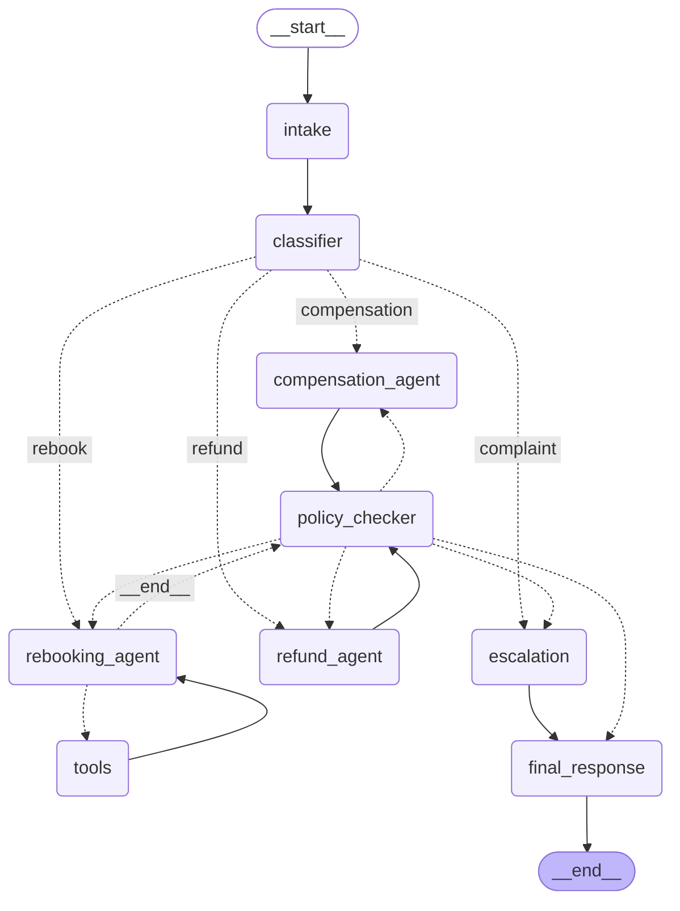

# Flight Disruption Rebooking Assistant

A small LangGraph app for airline passengers whose flight was cancelled or delayed.
The passenger sends a message. The graph works out what they want, proposes a solution
(new flight, refund or compensation), checks it against airline policy, and replies.
If the request is a complaint, or no solution passes the policy check, the case is handed to a human.

## How to run

```bash
python -m venv .venv
source .venv/bin/activate
pip install -r requirements.txt
cp .env.example .env        # then put your Groq API key in .env
python main.py              # runs all 4 scenarios + the follow-up
```

`main.py` prints each run and saves:
- `results.md`: input, path, tools called and final response for every scenario
- `graph.mmd`: the graph diagram from `graph.get_graph().draw_mermaid()`

Only one API key is needed (`GROQ_API_KEY`, free at console.groq.com). All airline tools are mocks.
The model is `openai/gpt-oss-120b` on Groq. To change it, set `MODEL_NAME` in `.env`.
The full run takes a few minutes because a rate limiter keeps requests under the Groq free-tier limits.

## Project structure

| File | What it contains |
|---|---|
| `state.py` | `RebookingState`, the typed state shared by all nodes |
| `tools.py` | Mock data and the 3 tools: `get_booking`, `search_flights`, `get_fare_rules` |
| `prompts.py` | Every LLM prompt, kept apart from the logic |
| `nodes.py` | The 9 nodes (agents + the plain-Python policy checker) |
| `graph.py` | The graph: nodes, edges and the routing functions |
| `main.py` | Runs the test scenarios with a checkpointer and thread_ids |

## Graph diagram



Dotted arrows are conditional edges. The `__end__` label on `rebooking_agent → policy_checker` is there
because `tools_condition` returns `"__end__"` when the LLM makes no tool call; I map that to `policy_checker`.

## Nodes

| Node | LLM? | Responsibility |
|---|---|---|
| `intake` | No | Loads the booking with `get_booking` (only if it isn't already saved), adds the message to the history, and resets the per-request fields |
| `classifier` | Yes, structured output | Extracts the `intent` (rebook / refund / compensation / complaint) and `constraints` (latest arrival, notes) |
| `rebooking_agent` | Yes, with tools | Decides which tools to call, loops with the ToolNode, then proposes one flight + cabin |
| `tools` | No | `ToolNode` that runs the tool calls the Rebooking Agent requested |
| `refund_agent` | Yes, structured output | Reads the booking and fare rules, proposes a refund amount |
| `compensation_agent` | Yes, structured output | Reads the booking's delay, proposes a compensation amount |
| `policy_checker` | **No** | Plain Python check of the proposal against the airline rules |
| `escalation` | Yes | Writes a short handover note for a human agent |
| `final_response` | Yes | Writes the reply to the passenger |

I added `intake` on top of the 8 reference nodes. It keeps "set up the request" apart from
"understand the request", and it is where the follow-up message reuses the saved booking.

## State design

`RebookingState` (in `state.py`) is a `TypedDict`, grouped by who writes each field:

| Field(s) | Written by | Purpose |
|---|---|---|
| `request_id`, `booking_ref`, `message` | caller (graph input) | The incoming request |
| `messages` | intake, rebooking_agent, tools, final_response | Conversation history **with the `add_messages` reducer** (appends instead of overwriting). The Rebooking Agent's tool calls and tool results are stored here, so tool use is visible in state |
| `booking` | intake | Booking details, saved once and reused on follow-ups |
| `intent`, `constraints` | classifier | What the passenger wants |
| `proposed_solution` | rebooking / refund / compensation agent | The flight, refund or compensation being proposed |
| `policy_passed`, `policy_failure_reason`, `retry_count` | policy_checker | The check result, why it failed, and how many checks failed |
| `escalated`, `escalation_note` | escalation | Whether a human takes over, and the handover note |
| `final_response` | final_response | The reply to the passenger |

Nodes return **only the fields they change**. `intake` also resets the per-request fields
(`proposed_solution`, `retry_count`, …) so a follow-up message on the same thread starts clean.

## Routing logic

All routing happens in conditional edges in `graph.py`. No node decides where to go next.

1. **`route_by_intent`** (after `classifier`): `rebook → rebooking_agent`, `refund → refund_agent`,
   `compensation → compensation_agent`, `complaint → escalation`.
2. **`tools_condition`** (after `rebooking_agent`): if the LLM requested a tool, go to `tools`,
   which loops back to `rebooking_agent`. Otherwise go to `policy_checker`.
3. **`route_after_policy`** (after `policy_checker`), which is the retry cycle:
   - passed → `final_response`
   - failed and `retry_count > MAX_RETRIES` (2) → `escalation`
   - failed otherwise → back to the agent that proposed the solution (looked up from the intent)

**Why the cycle always ends:** every failed check adds 1 to `retry_count`. After the first try plus
2 retries (`retry_count = 3`), the router must go to `escalation`. `main.py` also sets a
`recursion_limit` as a safety net.

**How the failure reason reaches the agent:** the policy checker saves `policy_failure_reason` in state.
On a retry, the Rebooking Agent adds it to the conversation as a message. The Refund and Compensation
agents add it to their prompt.

## Policy rules (`policy_checker` in `nodes.py`)

| Request | Rule |
|---|---|
| Rebook | Flight exists and the cabin is sold on it; same cabin class or lower; departs within 48 hours of the original departure; connection at least 60 minutes |
| Refund | Airline cancelled → full fare paid. Passenger choice on a non-refundable fare → taxes only (on a refundable fare → full fare) |
| Compensation | Delay under 3h → $0; 3 to 6h → $200; over 6h or cancelled → $400 |

## Tools (all mocks, in `tools.py`)

| Tool | Used by | Returns |
|---|---|---|
| `get_booking(booking_ref)` | intake, and the Rebooking Agent through the ToolNode | Passenger, route, cabin, fare type, fare paid, disruption |
| `search_flights(origin, destination, date)` | Rebooking Agent (through the ToolNode) | Flights with times, available cabins and connection |
| `get_fare_rules(fare_type)` | Refund Agent, policy checker | Refundable or not, tax amount |

The mock airline has a fixed "now" (`2026-10-03T09:00`), so "tomorrow noon" always means the same time.
Some search results break policy on purpose:
- `ADD → NBO`: only **business** class is left, so every proposal fails (scenario 3, the retry loop).
- `ADD → DXB`: `ET612` has a 45-minute connection and arrives too late. `ET604` is the correct choice.

## Checkpointer and threads

`main.py` compiles the graph with `MemorySaver()` and gives each passenger conversation its own
`thread_id` (for example `passenger-XK9L2P`). After every step, the state for that thread is saved.

The follow-up in scenario 1 (`"Actually, can I get a refund instead?"`) is sent on the **same thread_id with
no booking_ref**. LangGraph loads the saved state, so `intake` finds the booking already there and
does not ask for it again. The history keeps growing through the `add_messages` reducer.

## Test scenarios

| # | Scenario | Expected path |
|---|---|---|
| 1 | Cancelled flight, must arrive by noon (`XK9L2P`) | intake → classifier → rebooking_agent ⇄ tools → policy_checker (pass) → final_response |
| 1b | Follow-up on the same thread: "Actually, can I get a refund instead?" | intake → classifier → refund_agent → policy_checker (pass) → final_response |
| 2 | 6-hour delay, asks about compensation (`DL3M7Q`) | intake → classifier → compensation_agent → policy_checker (pass) → final_response |
| 3 | Only business class available (`BZ4Q8M`) | intake → classifier → rebooking_agent ⇄ tools → policy_checker (fails 3 times) → escalation → final_response |
| 4 | Complaint asking for a manager (`MG5T1R`) | intake → classifier → escalation → final_response |

### Results

Output of `python main.py` (model: `openai/gpt-oss-120b` on Groq):

#### Scenario 1: Cancelled flight, must arrive by noon

**thread_id:** `passenger-XK9L2P`

**Input message:** My flight to Dubai was cancelled. I need to be there by tomorrow noon.

**Path:** intake → classifier → rebooking_agent → tools → rebooking_agent → tools → rebooking_agent → policy_checker → final_response

**Tools called:** get_booking({'booking_ref': 'XK9L2P'}), search_flights({'date': '2026-10-03', 'destination': 'DXB', 'origin': 'ADD'})

**Intent:** rebook  |  **Policy passed:** True  |  **Failed checks (retry_count):** 0  |  **Escalated:** False

**Last policy failure reason:** none

**Proposed solution:** `{'type': 'rebook', 'flight_number': 'ET604', 'cabin': 'economy', 'flight': {'flight_number': 'ET604', 'departure': '2026-10-03T22:00', 'arrival': '2026-10-04T03:30', 'available_cabins': ['economy', 'business'], 'connection_airport': None, 'connection_minutes': None}}`

**Final response:**

Dear Mr. Kebede,

We’re sorry your original flight to Dubai was cancelled.  
We have rebooked you on flight ET604 in economy, departing 2026‑10‑03 at 22:00 and arriving 2026‑10‑04 at 03:30.  
Your new ticket has been automatically issued and is attached to your booking.  
Please check your email for the updated itinerary and e‑ticket.  
No further action is required from you unless you need a different schedule.  
As this case was not escalated, a human agent will not follow up.  

Safe travels,  
Ethiopian Airlines Customer Care

#### Scenario 1 follow-up: same thread, no booking reference given

**thread_id:** `passenger-XK9L2P`

**Input message:** Actually, can I get a refund instead?

**Path:** intake → classifier → refund_agent → policy_checker → final_response

**Tools called:** none

**Intent:** refund  |  **Policy passed:** True  |  **Failed checks (retry_count):** 0  |  **Escalated:** False

**Last policy failure reason:** none

**Proposed solution:** `{'type': 'refund', 'amount_usd': 520.0, 'explanation': 'The flight ET600 from ADD to DXB was cancelled by the airline. According to the refund policy, a cancellation by the airline entitles the passenger to a full refund of the fare paid, which is $520 USD.'}`

**Final response:**

Dear Mr. Kebede,

We’re sorry the ET600 flight from Addis Ababa to Dubai was cancelled by the airline.  
A full refund of $520 USD will be processed to your original payment method.  
The refund should appear on your statement within 5‑7 business days.  
You will receive an email confirmation once the transaction is complete.  
No further action is required on your part.  
A human agent will not follow up, as this request has been resolved automatically.  

Thank you for your understanding.

#### Scenario 2: 6-hour delay, asks about compensation

**thread_id:** `passenger-DL3M7Q`

**Input message:** My flight is delayed 6 hours. Am I entitled to anything?

**Path:** intake → classifier → compensation_agent → policy_checker → final_response

**Tools called:** none

**Intent:** compensation  |  **Policy passed:** True  |  **Failed checks (retry_count):** 0  |  **Escalated:** False

**Last policy failure reason:** none

**Proposed solution:** `{'type': 'compensation', 'amount_usd': 200.0, 'explanation': 'The flight was delayed by 6 hours, which falls within the 3 to 6 hour delay bracket. According to the compensation rules, this qualifies for a $200 compensation.'}`

**Final response:**

Dear Hana Girma,

We’re sorry for the 6‑hour delay on your flight. As per our policy, you are eligible for a $200 compensation, which has been processed to your original payment method.  
You will receive a confirmation email shortly with the details.  
If you have any further questions, feel free to reply to this message.  
Thank you for your patience.  
No human follow‑up is required at this time.

#### Scenario 3: Only business-class seats available

**thread_id:** `passenger-BZ4Q8M`

**Input message:** My flight to Nairobi was cancelled. Please put me on another flight.

**Path:** intake → classifier → rebooking_agent → tools → rebooking_agent → tools → rebooking_agent → policy_checker → rebooking_agent → tools → rebooking_agent → tools → rebooking_agent → tools → rebooking_agent → tools → rebooking_agent → tools → rebooking_agent → tools → rebooking_agent → tools → rebooking_agent → tools → rebooking_agent → tools → rebooking_agent → policy_checker → rebooking_agent → policy_checker → escalation → final_response

**Tools called:** get_booking({'booking_ref': 'BZ4Q8M'}), search_flights({'date': '2026-10-03', 'destination': 'NBO', 'origin': 'ADD'}), search_flights({'date': '2026-10-02', 'destination': 'NBO', 'origin': 'ADD'}), search_flights({'date': '2026-10-04', 'destination': 'NBO', 'origin': 'ADD'}), search_flights({'date': '2026-10-05', 'destination': 'NBO', 'origin': 'ADD'}), search_flights({'date': '2026-10-01', 'destination': 'NBO', 'origin': 'ADD'}), search_flights({'date': '2026-10-06', 'destination': 'NBO', 'origin': 'ADD'}), search_flights({'date': '2026-10-07', 'destination': 'NBO', 'origin': 'ADD'}), search_flights({'date': '2026-10-08', 'destination': 'NBO', 'origin': 'ADD'}), search_flights({'date': '2026-10-09', 'destination': 'NBO', 'origin': 'ADD'}), search_flights({'date': '2026-10-05', 'destination': 'NBO', 'origin': 'ADD'})

**Intent:** rebook  |  **Policy passed:** False  |  **Failed checks (retry_count):** 3  |  **Escalated:** True

**Last policy failure reason:** Cabin 'business' is higher than the booked 'economy' cabin.

**Proposed solution:** `{'type': 'rebook', 'flight_number': 'KQ311', 'cabin': 'business', 'flight': {'flight_number': 'KQ311', 'departure': '2026-10-04T07:00', 'arrival': '2026-10-04T09:05', 'available_cabins': ['business'], 'connection_airport': None, 'connection_minutes': None}}`

**Final response:**

Dear Mr. Alemu,

We’re sorry your ET306 flight to Nairobi was cancelled.  
Our system could not automatically place you in an economy‑class replacement, so a human agent is now reviewing your booking (BZ4Q8M) to find an eligible alternative or arrange a refund/compensation.  

You will receive a follow‑up email within the next 24 hours with the next steps.  

Thank you for your patience.  

Best regards,  
Customer Care Team (human agent will follow up)

#### Scenario 4: Complaint asking for a manager

**thread_id:** `passenger-MG5T1R`

**Input message:** This is the third time you've cancelled on me. I want to speak to a manager.

**Path:** intake → classifier → escalation → final_response

**Tools called:** none

**Intent:** complaint  |  **Policy passed:** None  |  **Failed checks (retry_count):** 0  |  **Escalated:** True

**Last policy failure reason:** none

**Proposed solution:** `None`

**Final response:**

Dear Selam Tadesse,

We regret the inconvenience caused by the third cancellation of flight ET809 (ADD‑JNB).  
At this time we have not issued a new flight or refund, as you have requested to speak directly with a manager.  
Our senior team is reviewing your case and will verify any compensation you may be entitled to.  
A manager will contact you within the next 24 hours to discuss a personalized solution.  
Please let us know the best phone number or email for this follow‑up.  

A human agent will be in touch shortly. Thank you for your patience.
